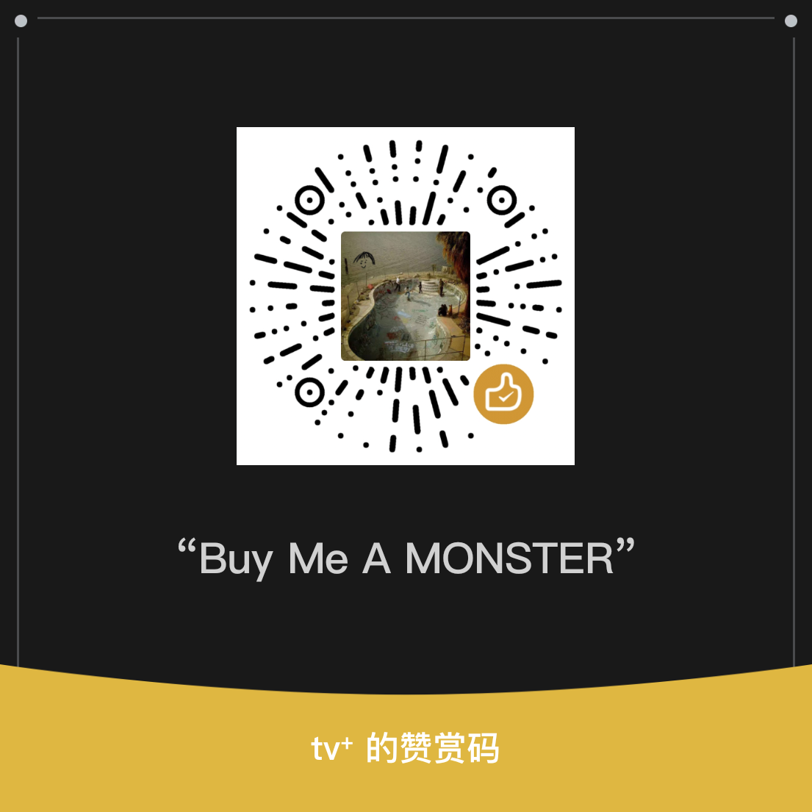

# CustoMIUIzer A14

[简体中文](README.md) | English

A system UI and interaction customization module maintained for **HyperOS 1 / Android 14**, derived from CustoMIUIzer. Supports **arm64-v8a** and requires **libxposed API 102 or later**.

[Download the official release](https://github.com/thetvplus/customiuizer-a14/releases/latest) · [Changelog](CHANGELOG_EN.md) · [Report an issue](https://github.com/thetvplus/customiuizer-a14/issues)

## Main Features

- **System**: status bar, Duo icon, Dynamic Island, notifications, Control Center, lock screen, audio and vibration.
- **Home screen**: Dock backgrounds and materials, layout, folders, app titles and gestures.
- **Buttons and gestures**: power, volume and fingerprint keys, navigation bar and custom actions.
- **Apps and maintenance**: installer, app management, permission prompts, and recoverable maintenance and privacy operations.

See the [compact feature map](docs/FEATURE_MAP_SIMPLE.md) for all pages. Detailed behavior is documented in the [Dynamic Island](docs/features/island/README.md), [Duo](docs/features/duo-status-bar.md) and [Dock](docs/features/dock/README.md) guides.

## Installation

1. Download and install the official APK. Updates signed with the same certificate preserve app data.
2. Enable the module in your Xposed framework and grant the required scopes.
3. Restart the affected process or device, then enable the features you need. Hooks selected at installation time require restarting their target process after changing the switch.

Availability depends on the ROM and system-app versions. Do not enable this module together with upstream or another CustoMIUIzer-derived module. Other major Android or HyperOS versions are unsupported; see the [compatibility matrix](COMPATIBILITY.md).

## Documentation and Development

The [documentation index](docs/README.md) covers development, testing, releases and feature contracts. Start with the [shared engineering rules](AGENTS.md) before contributing.

Current source version: `r14.25.5` (versionCode 250). Maintainer: `thetvplus`. Application ID: `tv.withaibuild.customiuizer.r14`.

Later source-branch changes may be absent from the official APK with the same version name. See the [current refinement state](docs/maintenance/A14_REFINEMENT_ROADMAP.md) for unreleased changes and pending device checks.

## Support and License

Support continued maintenance via WeChat or [PayPal](https://paypal.me/Jinjitv).

Distributed under [GPL-3.0](LICENSE). Derived from [Mikanoshi/CustoMIUIzer](https://github.com/Mikanoshi/CustoMIUIzer), with Android 14 work referenced from [MonwF/customiuizer](https://github.com/MonwF/customiuizer). Duo references and bundled licenses are listed in the [Duo notes](docs/features/duo-status-bar.md).
